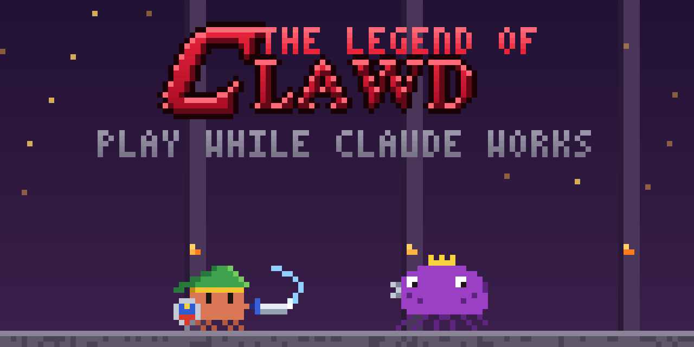

<p align="center">
  
</p>

<p align="center">
  <b>A little Zelda-style adventure you play in the terminal, right above the Claude Code prompt — while Claude works.</b>
</p>

<p align="center">
  <a href="#install"></a>
  
  
</p>

<p align="center">
  <a href="#install">Install</a> ·
  <a href="#controls">Controls</a> ·
  <a href="#screenshots">Screenshots</a> ·
  <a href="#dev-tools">Dev tools</a>
</p>

<p align="center">
  
</p>

## What it is

Legend of Clawd is a Claude Code mod. Type `/legend` and a small side-scrolling game opens in the band above the prompt. Clawd, with a green hat and a sword, walks through a meadow, a forest and a cave, then faces the Bug King in his arena.

The game knows what Claude is doing:

| When…                          | The game…                                         |
| ------------------------------ | ------------------------------------------------- |
| ✅ Claude is done              | a fairy shouts *"Hey! Listen! Claude is done."*   |
| ✋ Claude needs your OK        | the fairy tells you, and the game waits for you   |
| ⌨️ You start typing the prompt | the game pauses                                   |

Your best time is saved between sessions.

## Install

In Claude Code:

```
/plugin marketplace add itsyunusacar/Legend-of-Clawd
/plugin install legend-of-clawd@legend-of-clawd
```

Then type `/legend` to open the game, and `/legend` again to close it.

## Controls

| Key       | Action             |
| :-------: | ------------------ |
| `←` `→`   | Walk               |
| `↑`       | Jump               |
| `Z`       | Sword              |
| `X`       | Shield             |
| `Esc`     | Back to the prompt |
| Click     | Back to the game   |

> [!NOTE]
> The game runs in the terminal. In the desktop app it shows a short note instead.

## Screenshots

<table>
  <tr>
    <td width="50%" valign="top">
      <p align="center"><b>Every scene, start to finish</b></p>
      
    </td>
    <td width="50%" valign="top">
      <p align="center"><b>The journey</b></p>
      <ol>
        <li><b>Title</b> — click to play</li>
        <li><b>Meadow</b> — first bugs, first sword swings</li>
        <li><b>Forest</b> — stone ledges and bats</li>
        <li><b>Paused</b> — you started typing, so the game waits</li>
        <li><b>Cave</b> — slimes in the dark</li>
        <li><b>Arena</b> — the Bug King wakes up and charges</li>
        <li><b>Victory</b> — Clawd holds up the triangle</li>
        <li><b>The end</b> — play again or quit</li>
      </ol>
    </td>
  </tr>
</table>

<p align="center"><b>Sprites</b> — every frame, on a light and a dark terminal</p>

<p align="center">
  
</p>

## Project layout

```
.claude-plugin/   plugin and marketplace manifests
hooks/
  register.ts     the mod: /legend command, events, best time, the band above the prompt
  screen.ts       the drawing side: runs the game loop and handles keys
  game.ts         game logic: physics, enemies, the boss, modes
  level.ts        the one level: ground, walls, zones, checkpoints
  draw.ts         turns the scene into terminal cells (two pixels per cell, '▀')
  sprites.js      pixel art and palette
  logo.ts         the title logo
  texts.ts        every line the game says
tests/            tests for the game and the drawing
tools/            dev tools that render PNGs and play the level with a bot
media/            the cover and the gameplay GIF for this page
```

## Dev tools

```bash
node tools/preview.mjs preview.png   # one frame of each scene
node tools/sheet.mjs sheet.png       # every sprite frame
node tools/logo.mjs logo.png         # the title logo, enlarged
node tools/bot.mjs                   # checks a bot can finish the level
node tools/gif.mjs gameplay.gif      # records the bot's run as a GIF (needs ffmpeg)
node tools/cover.mjs cover.png       # the 1280×640 cover
```

---

<p align="center">Made by Yunus Acar · <i>It's dangerous to code alone. Take this.</i> 🗡️</p>
