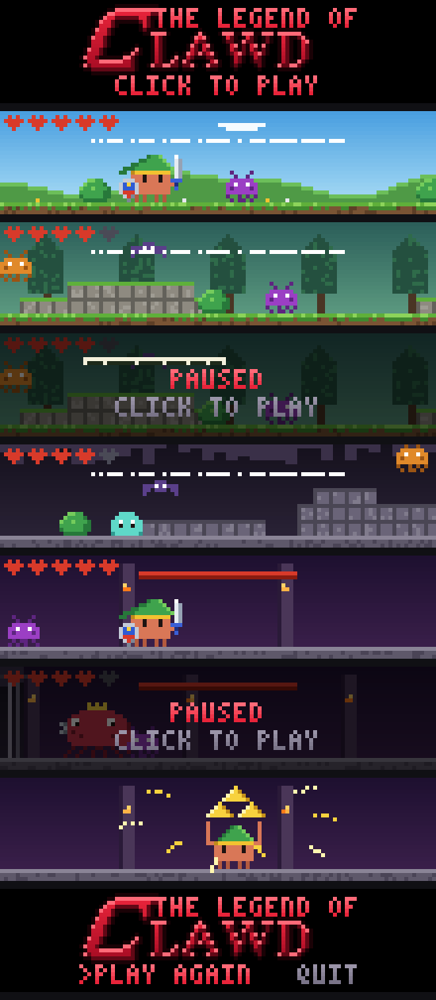
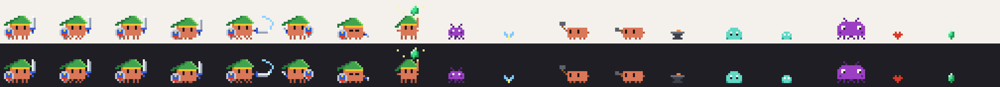

# Legend of Clawd

A little Zelda-style adventure you play in the terminal, right above the Claude Code prompt — while Claude works.



## What it is

Legend of Clawd is a Claude Code mod. Type `/legend` and a small side-scrolling game opens in the band above the prompt. Clawd, with a green hat and a sword, walks through a meadow, a forest and a cave, then faces the Bug King in his arena.

The game knows what Claude is doing:

- **Claude is done:** a fairy shouts *"Hey! Listen! Claude is done."*
- **Claude needs your OK:** the fairy tells you, and the game waits for you.
- **You start typing at the prompt:** the game pauses.

Your best time is saved between sessions.

## Install

In Claude Code:

```
/plugin marketplace add itsyunusacar/Legend-of-Clawd
/plugin install legend-of-clawd@legend-of-clawd
```

Then type `/legend` to open the game, and `/legend` again to close it.

## Controls

| Key   | Action                 |
| ----- | ---------------------- |
| ← →   | Walk                   |
| ↑     | Jump                   |
| Z     | Sword                  |
| X     | Shield                 |
| Esc   | Back to the prompt     |
| Click | Back to the game       |

The game runs in the terminal. In the desktop app it shows a short note instead.

## Project layout

```
.claude-plugin/   plugin and marketplace manifests
hooks/
  register.ts     the mod: /legend command, events, best time, the band above the prompt
  screen.ts       the drawing side: runs the game loop and handles keys
  game.ts         game logic: physics, enemies, the boss, modes
  level.ts        the one level: ground, walls, zones, checkpoints
  draw.ts         turns the scene into terminal cells (two pixels per cell, '▀')
  sprites.js      pixel art and palette
  logo.ts         the title logo
  texts.ts        every line the game says
tests/            tests for the game and the drawing
tools/            dev tools that render PNGs and play the level with a bot
```

## Dev tools

```bash
node tools/preview.mjs preview.png   # one frame of each scene
node tools/sheet.mjs sheet.png       # every sprite frame
node tools/logo.mjs logo.png         # the title logo, enlarged
node tools/bot.mjs                   # checks a bot can finish the level
```



## Author

Made by Yunus Acar.
